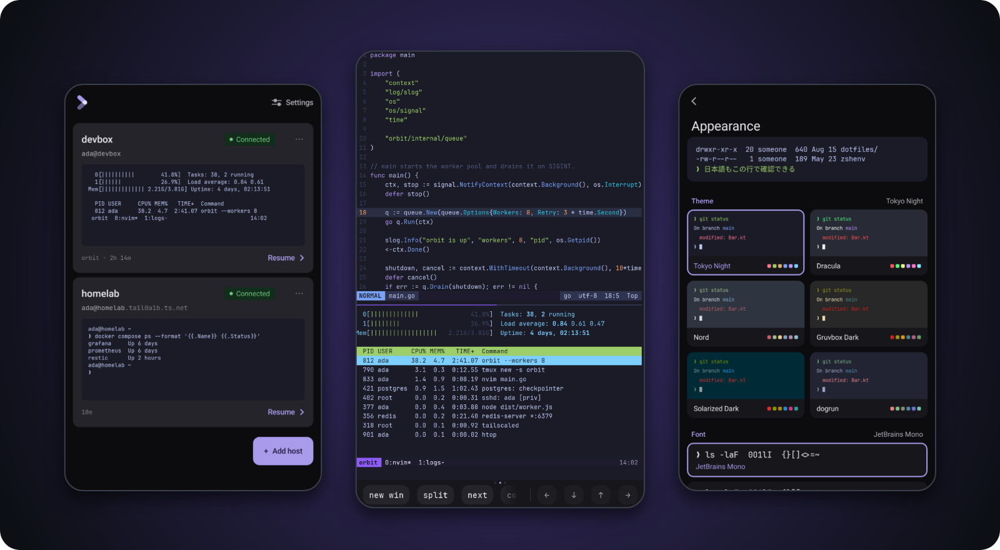
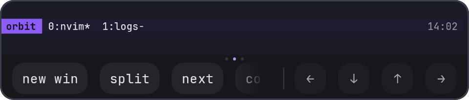
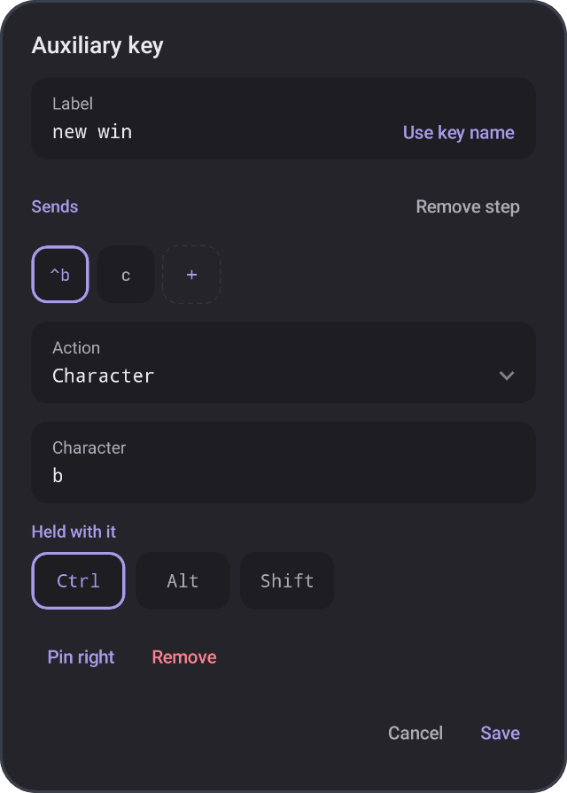
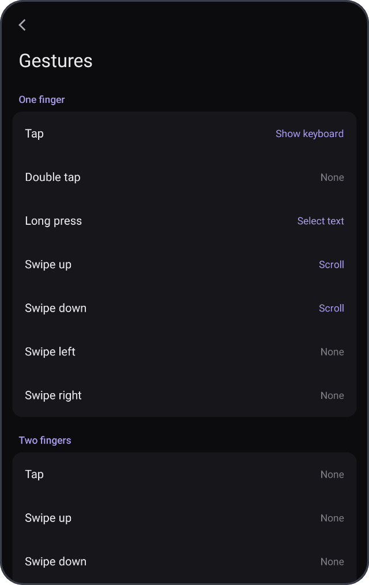
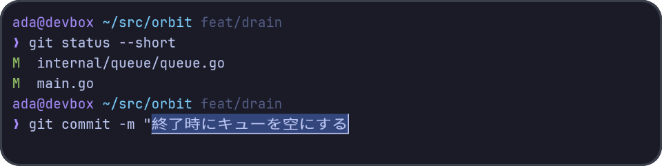
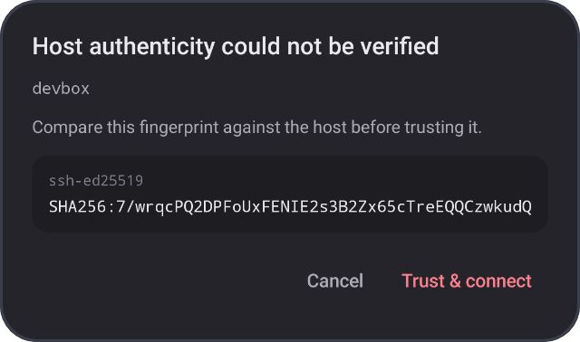

<div align="center">


# Limenty

**An SSH terminal for Android, built for tmux, Neovim and typing on a phone.**

[Features](#features) · [Building](#building) · [Architecture](docs/architecture.md) · [Security](docs/security.md)

[](https://github.com/wadackel/limenty/actions/workflows/ci.yaml)
[](LICENSE)


</div>

<p align="center"></p>

> [!NOTE]
> Limenty is a personal project. There are no prebuilt APKs: [build it from source](#building).
> Issues and pull requests are not open to outside contributors; security reports are welcome
> through [private vulnerability reporting](SECURITY.md).

## Features

### A terminal emulator written for this app

Truecolor and 256 colours, the alternate screen, bracketed paste, mouse reporting (SGR and
UTF-8), xterm `modifyOtherKeys` so Neovim can tell `Ctrl-Enter` from `Enter`, and OSC 52 so a
yank in tmux or Neovim lands on the Android clipboard. Images drawn with the
[kitty graphics protocol](https://sw.kovidgoyal.net/kitty/graphics-protocol/) show up inline,
so `kitten icat` and `chafa` work. Wide and CJK characters take the width the remote expects,
Powerline separators are drawn as shapes rather than glyphs, and a bundled Nerd Font fills in
icons.

### Made for a touch screen

<p align="center"></p>
<p align="center"><sub>A key bar set named <code>tmux</code>. Its first key sends <code>Ctrl-b</code> then <code>c</code>; the dots above the bar show there are two more sets to swipe to.</sub></p>

- **Key bar sets.** A row of keys above the keyboard, with arrows pinned on the right. Keep
  several named sets and swipe the bar up or down to switch between them.
- **Keys that send more than one key.** A single button can send `Ctrl-b` then `c`, or type
  `git status`, under whatever label you give it.
- **A drag arrow pad.** Long-press and slide to send repeating arrow keys in that direction.
- **Gestures you choose.** Fourteen gestures, from double tap to two-finger swipes and pinch,
  each bound to an action: show the keyboard, paste, scroll, zoom the font, or send a key.

> [!TIP]
> Turn on mouse mode in tmux (`set -g mouse on`) and a touch scroll moves tmux panes and Neovim
> buffers, because Limenty sends it as wheel events.

<p align="center">
  &nbsp;&nbsp;
  
</p>
<p align="center"><sub>A key with two steps, labelled <code>new win</code>, and the gesture bindings in settings.</sub></p>

### Japanese and other IME input that does not corrupt

<p align="center"></p>

Composition is drawn inline at the cursor, and nothing is sent to the remote until you commit. A
physical key pressed mid-composition commits, cancels or interrupts the composition instead of
leaking a stray byte. A test enforces that zero bytes go out while composing.

### A hardware keyboard, mouse or trackpad

Ctrl, Alt, Shift and Meta map as a desktop terminal would, including F1–F12 and the xterm
modified-key encodings. A mouse, stylus or trackpad is reported to the remote; a finger never is.

### Sessions that stay put

Connect to several hosts at once. The host list shows a live preview of each connected screen,
and a session keeps running while you are elsewhere in the app or outside it. Folding,
unfolding and rotating resize the terminal without dropping the connection.

### Finds machines on your network

Macs with Remote Login and other hosts advertising `_ssh._tcp` over Bonjour appear in the host
list. A saved one is found again by name when its address changes, and its host key is trusted
under that name.

### Careful by default

- Passwords are encrypted with AES-GCM under a key held in the Android Keystore.
- An unknown host key shows its `SHA256` fingerprint before you trust it. A changed key refuses
  to connect, with no "trust anyway".
- The remote can write to the clipboard but never read it, and only while Limenty is in front.
- What you type is never logged: input records carry lengths and character classes, not text.

<p align="center"></p>
<p align="center"><sub>The prompt on first connect, with the fingerprint to compare against <code>ssh-keygen -lf</code>.</sub></p>

The details are in [`docs/security.md`](docs/security.md).

### Looks

Tokyo Night, Dracula, Nord, Gruvbox Dark, Solarized Dark and dogrun; JetBrains Mono, Fira Code
and Hack; font size, line height and letter spacing are adjustable and apply as you drag.

## Limitations

> [!IMPORTANT]
> **Password authentication only.** There is no public-key authentication yet.

- No port forwarding, jump hosts, agent forwarding, SFTP or mosh.
- Requires Android 11 or later.

## Building

You need [Nix](https://nixos.org/download/) with flakes enabled, and the Android SDK at
`~/Library/Android/sdk` or wherever `ANDROID_HOME` points. The JDK comes from the flake, and
Gradle from the wrapper.

```sh
git clone https://github.com/wadackel/limenty.git
cd limenty
./gw :app:assembleDebug     # ./gw runs the Gradle wrapper inside `nix develop`
```

The APK is written to `app/build/outputs/apk/debug/`. With a device attached, `tools/app run`
builds, installs and launches it.

[`docs/development.md`](docs/development.md) covers the module layout, tests, the emulator and
device tools, and how to diagnose a failure on a real device.

## License

Limenty is released under the [MIT License](LICENSE). The bundled fonts keep their own
licences, which ship in the APK and are listed on the app's About screen.
